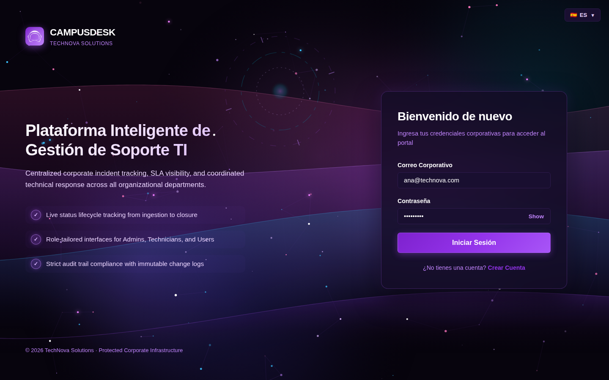
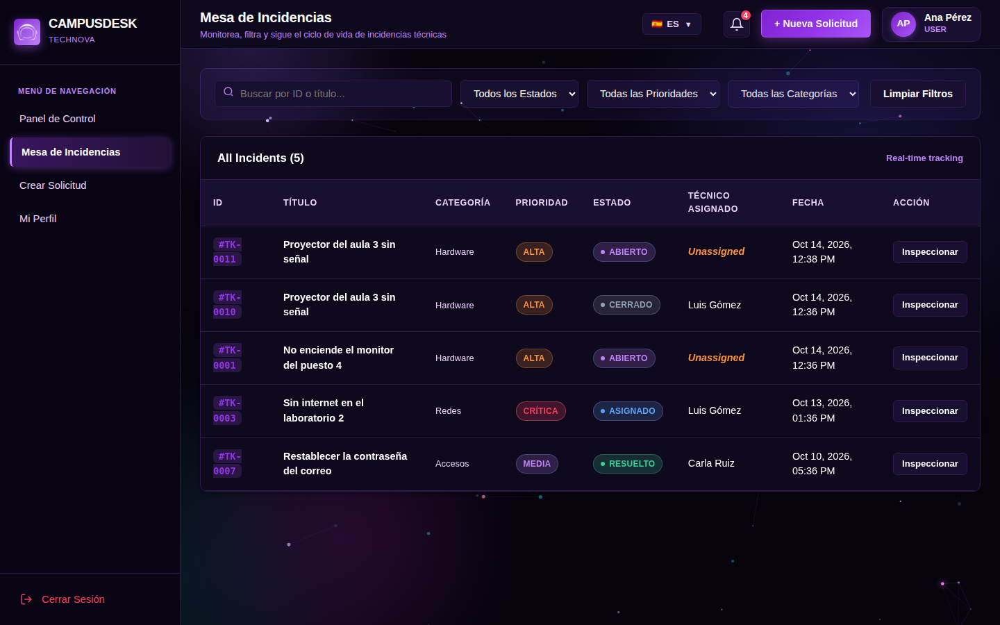
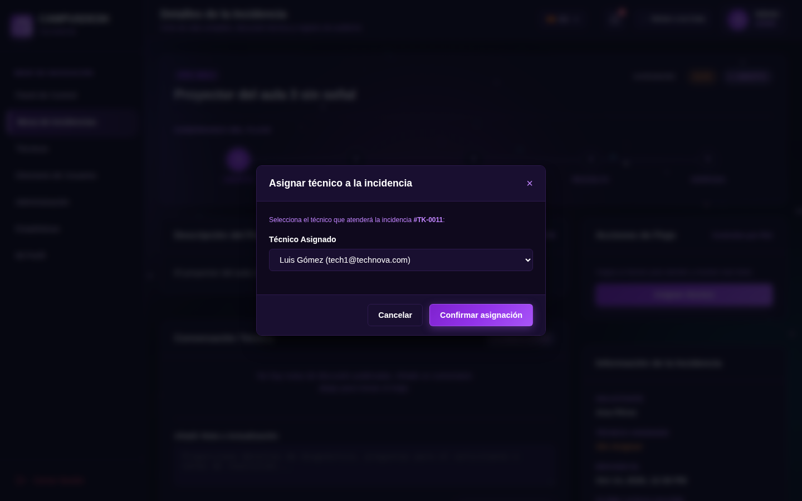
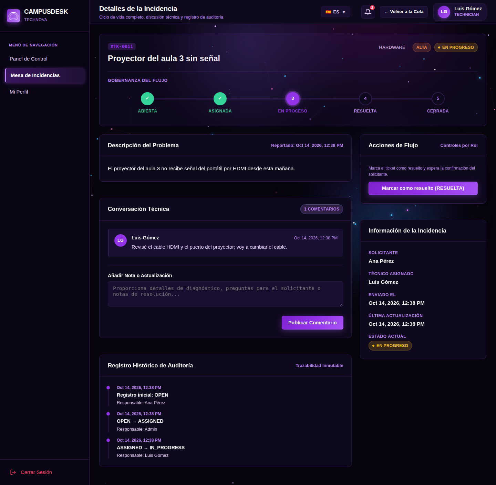
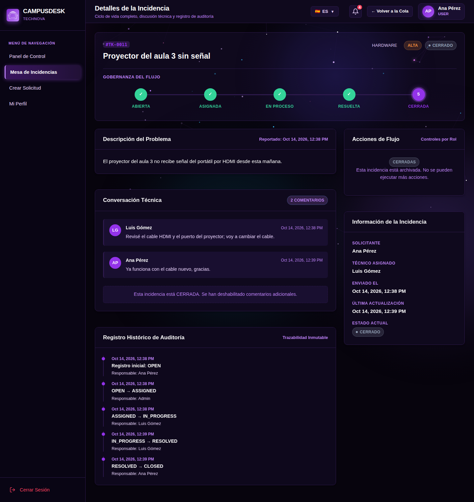
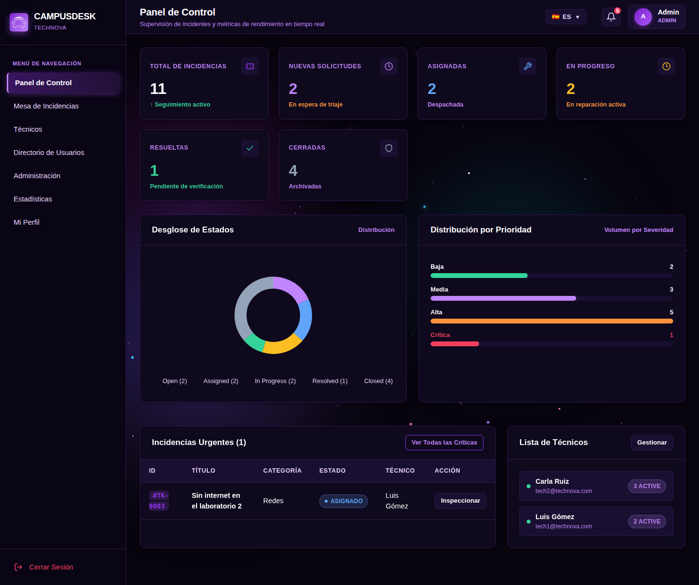
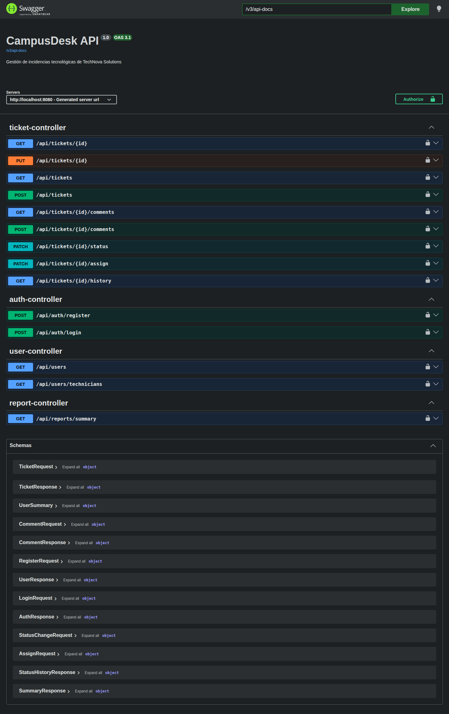

# CampusDesk

Plataforma web de gestión de incidencias tecnológicas para TechNova Solutions: centraliza las solicitudes de soporte, controla su ciclo de vida (OPEN → ASSIGNED → IN_PROGRESS → RESOLVED → CLOSED) y protege la información según el rol de cada usuario.

> Dueño de este archivo: Persona 4. Cada persona le pasa los datos de su zona.

## Integrantes

| Persona | Nombre | Rama | Zona |
|---|---|---|---|
| Persona 1 | Jonatan Sarmiento | `Devjonatan` | Backend: seguridad, usuarios e indicadores |
| Persona 2 | Nikolas Tolosa | `DevNic` | Backend: tickets y reglas del negocio |
| Persona 3 | Sergio Velasco | `DevSergy` | Frontend |
| Persona 4 | Michael Santos | `DevMic` | Base de datos, pruebas y documentación |

## Avance

Actualizado el 2026-10-14.

| Zona | Estado |
|---|---|
| Seguridad, usuarios e indicadores (P1) | Terminado: JWT, `SecurityConfig`, registro, login, usuarios, técnicos, `GET /reports/summary`, `DataInitializer`, CORS, Swagger y manejo de errores, con pruebas |
| Tickets y reglas del negocio (P2) | Terminado: los 9 endpoints de tickets del contrato y las 10 reglas del ciclo de vida (RF-04) |
| Frontend (P3) | Terminado: las 5 pantallas del enunciado conectadas a la API, sin datos simulados, con edición de tickets y aviso cuando el backend no responde |
| Base de datos (P4) | Terminado: enums, entidades, repositorios, `schema.sql`, `data.sql`, diagrama ER, PostgreSQL con Docker |
| Pruebas y documentación (P4) | Terminado: 134 pruebas automáticas (incluidos CP-01 a CP-16), README y evidencias |

## Tecnologías

- Backend: Java 21, Spring Boot 4.1.1 (Web, Data JPA, Security, Validation), JWT (JJWT 0.13.0), SpringDoc OpenAPI 3.1.0 (Swagger), Gradle
- Base de datos: PostgreSQL 17 (con Docker o instalado en el computador); H2 en memoria solo para las pruebas
- Frontend: HTML5, CSS3 y JavaScript sin frameworks

## Estructura del repositorio

```
campusdesk/
├── backend/                              Proyecto Spring Boot (Gradle)
│   ├── build.gradle                      Dependencias
│   ├── gradlew, gradlew.bat              Ejecutan Gradle sin instalarlo
│   ├── .env.example                      Variables de entorno (copiar como .env)
│   ├── docker-compose.yml   Persona 4    PostgreSQL para desarrollo (opcional)
│   ├── src/main/java/com/technova/campusdesk/
│   │   ├── CampusDeskApplication.java   Clase principal
│   │   ├── config/          Persona 1    CORS, Swagger, DataInitializer
│   │   ├── security/        Persona 1    JWT, filtros, SecurityConfig
│   │   ├── exception/       Persona 1    ErrorResponse, GlobalExceptionHandler
│   │   ├── controller/      P1 y P2      Auth/User/Report (P1) · Ticket* (P2)
│   │   ├── service/         P1 y P2      Auth/User/Report (P1) · Ticket*, Comment, StatusHistory (P2)
│   │   ├── dto/request/     P1 y P2
│   │   ├── dto/response/    P1 y P2
│   │   ├── mapper/          Persona 2
│   │   ├── entity/          Persona 4    User, Ticket, Comment, StatusHistory
│   │   ├── entity/enums/    Persona 4    Role, Category, Priority, TicketStatus
│   │   └── repository/      Persona 4
│   └── src/test/
│       ├── resources/application-test.yml   Persona 4    Perfil de pruebas (H2)
│       └── java/.../repository/             Persona 4    Pruebas de repositorios
├── frontend/                Persona 3    5 pantallas, css/, js/
├── database/                Persona 4    schema.sql, data.sql
└── docs/                    Persona 4    api-contract.md, er-diagram.md, evidencias/
```

En los paquetes compartidos (`controller`, `service`, `dto`) cada persona trabaja en sus propios archivos, así no hay conflictos de Git.

## Ramas

- `main`: versión estable para la entrega. Solo recibe merges desde `develop`.
- `develop`: integración del equipo. Solo recibe pull requests desde las ramas personales.
- `Devjonatan`, `DevNic`, `DevSergy`, `DevMic`: rama de trabajo de cada integrante (ver tabla de integrantes).

Nadie hace push directo a `develop` ni a `main`.

## Requisitos previos

- JDK 21 (los cuatro con la misma versión)
- PostgreSQL 17, de una de estas dos formas:
  - Docker con Docker Compose (recomendado: no hay que instalar PostgreSQL), o
  - PostgreSQL instalado en el computador
- Git
- VS Code con la extensión Live Server (o similar) para el frontend

No hace falta instalar Gradle: el proyecto trae `gradlew`, que lo descarga solo la primera vez.

## Configuración (variables de entorno)

Copiar `backend/.env.example` como `backend/.env` y completar los valores. El archivo `.env` no se sube al repositorio. Spring Boot y Docker Compose lo leen al ejecutarse desde la carpeta `backend/`.

| Variable | Para qué sirve | Valor por defecto |
|---|---|---|
| `DB_URL` | URL JDBC de la base | `jdbc:postgresql://localhost:5432/campusdesk` |
| `DB_USERNAME` | Usuario de PostgreSQL (con Docker, se crea con este nombre) | — (obligatoria) |
| `DB_PASSWORD` | Contraseña de PostgreSQL (con Docker, se crea con esta contraseña) | — (obligatoria) |
| `JPA_DDL_AUTO` | Qué hace Hibernate con las tablas. Recomendado: `validate`, porque las tablas las crea `schema.sql` | `update` |
| `SERVER_PORT` | Puerto del backend | `8080` |
| `JWT_SECRET` | Clave para firmar los tokens. Mínimo 32 caracteres; se puede generar con `openssl rand -base64 48` | — (obligatoria) |
| `JWT_EXPIRATION_MS` | Duración del token en milisegundos | `3600000` (1 hora) |
| `CORS_ALLOWED_ORIGINS` | Orígenes del frontend que pueden llamar a la API | `http://127.0.0.1:5500,http://localhost:5500` |
| `ADMIN_EMAIL` | Correo del ADMIN que crea el DataInitializer | — |
| `ADMIN_PASSWORD` | Contraseña de ese ADMIN | — |
| `TECH_PASSWORD` | Contraseña de los técnicos que crea el DataInitializer | — |

## Preparar PostgreSQL

### Opción A: Docker (recomendada)

Desde la carpeta `backend/`, con el `.env` ya creado:

```bash
docker compose up -d       # crea el contenedor campusdesk-postgres, la base campusdesk y ejecuta schema.sql
docker compose down        # lo detiene (los datos se conservan)
docker compose down -v     # borra la base; al volver a levantarla se ejecuta otra vez schema.sql
```

`database/schema.sql` solo se ejecuta cuando la base se crea desde cero. Si cambia el esquema, hay que hacer `docker compose down -v` y `docker compose up -d`.

### Opción B: PostgreSQL instalado

```bash
psql -U postgres -c "CREATE DATABASE campusdesk;"
psql -U postgres -d campusdesk -f database/schema.sql
```

`schema.sql` borra y vuelve a crear las tablas, así que se puede ejecutar de nuevo para empezar desde cero.

### Datos de prueba

Hay que seguir este orden, porque `data.sql` asigna tickets a los técnicos que crea el backend:

1. Base creada con `schema.sql` (con Docker se crea sola).
2. Arrancar el backend una vez. Su `DataInitializer` crea al ADMIN y a los técnicos. Se puede arrancar las veces que sea: no los duplica.
3. Cargar `database/data.sql`, desde la raíz del repositorio:

```bash
# Docker
docker exec -i campusdesk-postgres psql -U postgres -d campusdesk -v ON_ERROR_STOP=1 < database/data.sql
# PostgreSQL instalado
psql -U postgres -d campusdesk -v ON_ERROR_STOP=1 -f database/data.sql
```

Si se ejecuta antes del paso 2, se detiene con un aviso y no inserta nada. Se puede volver a ejecutar cuando se quiera: borra y recrea los tickets de prueba, sin duplicar usuarios.

| Usuario | Correo | Contraseña | Rol | Lo crea |
|---|---|---|---|---|
| Admin | valor de `ADMIN_EMAIL` (por defecto `admin@technova.com`) | valor de `ADMIN_PASSWORD` | ADMIN | `DataInitializer` |
| Luis Gómez | `tech1@technova.com` | valor de `TECH_PASSWORD` | TECHNICIAN | `DataInitializer` |
| Carla Ruiz | `tech2@technova.com` | valor de `TECH_PASSWORD` | TECHNICIAN | `DataInitializer` |
| Ana Pérez | `ana@technova.com` | `User12345` | USER | `data.sql` |
| Pedro Díaz | `pedro@technova.com` | `User12345` | USER | `data.sql` |
| Sofía Torres | `sofia@technova.com` | `User12345` | USER | `data.sql` |

`data.sql` crea además 9 tickets que cubren los 5 estados (2 OPEN, 2 ASSIGNED, 2 IN_PROGRESS, 1 RESOLVED, 2 CLOSED), todas las categorías y prioridades, con su historial completo de cambios de estado y comentarios. Las contraseñas de `User12345` solo valen para pruebas locales.

### Modelo de datos

Tablas `users`, `tickets`, `comments` y `status_history`. El diagrama entidad-relación está en [`docs/er-diagram.md`](docs/er-diagram.md).

## Ejecución

Backend, desde la carpeta `backend/`:

- Mac o Linux: `./gradlew bootRun`
- Windows: `gradlew.bat bootRun`

Queda escuchando en `http://localhost:8080`. Si `JPA_DDL_AUTO=validate` y la aplicación arranca, las entidades coinciden con las tablas de `schema.sql`.

Frontend, con el backend ya en marcha. Son archivos estáticos (HTML, CSS y JavaScript sin frameworks), así que basta con servir la carpeta `frontend/` en el puerto 5500, que es el origen permitido por defecto en `CORS_ALLOWED_ORIGINS`:

- **VS Code:** abrir la carpeta `frontend/` y pulsar **Go Live** (extensión Live Server). Se abre `http://127.0.0.1:5500`.
- **Sin VS Code:** desde la carpeta `frontend/`, ejecutar `python3 -m http.server 5500 --bind 127.0.0.1` y abrir `http://127.0.0.1:5500` en el navegador.

El frontend llama a la API en `http://localhost:8080/api`. Si el backend corre en otro puerto o el frontend en otro origen, hay que ajustar `API_BASE_URL` en `frontend/js/api.js` y `CORS_ALLOWED_ORIGINS` en el `.env`.

## Pruebas

Desde la carpeta `backend/`:

```bash
./gradlew test
```

Las pruebas usan el perfil `test` (`src/test/resources/application-test.yml`): una base H2 en memoria en modo PostgreSQL, así que no necesitan PostgreSQL, Docker ni el archivo `.env`. Cargan el mismo `database/schema.sql` y validan las entidades contra él: si el esquema y las entidades dejan de coincidir, las pruebas fallan.

| Área | Clases | Qué prueban |
|---|---|---|
| API de tickets, de punta a punta | `TicketApiIntegrationTest`, `TicketWorkflowApiIntegrationTest`, `TicketActivityApiIntegrationTest` (base común: `ApiIntegrationTestSupport`) | Petición HTTP con JWT real hasta la base, según el contrato: visibilidad por rol, filtros, detalle, creación y edición; asignación y ciclo de estados completo con sus permisos y transiciones inválidas; historial y comentarios (acceso, orden, validaciones, ticket `CLOSED`) |
| Seguridad y autenticación | `SecurityConfigTest`, `JwtServiceTest`, `JwtAuthenticationFilterTest`, `SecurityUtilsTest`, `AuthControllerTest`, `AuthServiceTest`, `RegisterRequestTest` | Token, 401 y 403, registro, login y política de contraseña |
| Usuarios e indicadores | `UserControllerTest`, `UserServiceTest`, `ReportControllerTest`, `ReportServiceTest` | Listados solo para ADMIN y conteos por rol |
| Reglas de tickets | `TicketTransitionPolicyTest` | Transiciones de estado permitidas y prohibidas |
| Repositorios | `UserRepositoryTest`, `TicketRepositoryTest`, `TicketActivityRepositoryTest` | Consultas, carga de relaciones, conteos y orden cronológico |
| Configuración y errores | `CampusDeskApplicationTests`, `DataInitializerTest`, `OpenApiConfigTest`, `GlobalExceptionHandlerTest` | Arranque, usuarios iniciales, Swagger y formato de error |

### Casos de prueba del enunciado (CP-01 a CP-16)

Cada caso obligatorio tiene su propia prueba automática en `AcceptanceCasesApiIntegrationTest`, con el código del caso en el nombre. Para correr solo esos 16, desde `backend/`:

```bash
./gradlew test --tests '*AcceptanceCases*'
```

Para la demostración en vivo se usan las cuentas de "Datos de prueba".

| Código | Escenario | Resultado esperado | Resultado actual | Cómo demostrarlo en vivo |
|---|---|---|---|---|
| CP-01 | Registrar un usuario válido | Cuenta creada con rol USER | 201, rol `USER` aunque se envíe otro | Pantalla de registro o `POST /api/auth/register` en Swagger |
| CP-02 | Registrar un correo duplicado | Rechazo | 409 (también con mayúsculas en el correo) | Registrar otra vez `ana@technova.com` |
| CP-03 | Iniciar sesión correctamente | JWT válido | 200 con `token`, que sirve en rutas protegidas | Login en la app o `POST /api/auth/login` en Swagger |
| CP-04 | Endpoint protegido sin token | 401 | 401 en JSON | `GET /api/tickets` en Swagger sin pulsar Authorize |
| CP-05 | Crear un ticket | Estado inicial abierto | 201, estado `OPEN` | Ana crea un ticket desde la app |
| CP-06 | USER consulta un ticket ajeno | 403 o 404 | 403 | Ana abre `GET /api/tickets/{id}` de un ticket de Pedro |
| CP-07 | ADMIN asigna un técnico | Pasa a asignado | 200, estado `ASSIGNED` con el técnico | El admin asigna desde la pantalla de administración |
| CP-08 | USER intenta asignar | 403 | 403 | Ana llama a `PATCH /api/tickets/{id}/assign` en Swagger |
| CP-09 | Técnico modifica un ticket ajeno | Rechazo | 403 al cambiar estado o editar | Carla intenta mover un ticket asignado a Luis |
| CP-10 | Resolver sin pasar por en proceso | 409 | 409 | Luis pasa un ticket `ASSIGNED` directo a `RESOLVED` |
| CP-11 | Cambio de estado | Registro en el historial | Nuevo registro con estado anterior, nuevo, usuario y fecha | Ver el historial en el detalle del ticket |
| CP-12 | El solicitante cierra su ticket resuelto | Cerrado | 200, estado `CLOSED` | Ana cierra un ticket `RESOLVED` |
| CP-13 | Comentar un ticket cerrado | Rechazo | 409 | Comentar en un ticket `CLOSED` |
| CP-14 | Consultar estadísticas | Coinciden con PostgreSQL | Coinciden por rol (ADMIN todo, TECHNICIAN asignados, USER propios) | Dashboard y `SELECT status, COUNT(*) FROM tickets GROUP BY status;` |
| CP-15 | Consumir la API desde el frontend autorizado | Comunicación exitosa | CORS permite `CORS_ALLOWED_ORIGINS` y rechaza otros orígenes | Usar la app desde Live Server (`http://127.0.0.1:5500`) |
| CP-16 | JWT inválido o expirado | 401 | 401 con token mal formado, vencido o firmado con otra clave | En Swagger, Authorize con un token modificado |

## Roles

| Rol | Qué puede hacer |
|---|---|
| ADMIN | Ver todos los tickets, asignar un técnico, ver la lista de usuarios y de técnicos, ver el dashboard con todos los tickets, y ver el historial y comentar en cualquier ticket. |
| TECHNICIAN | Ver los tickets que tiene asignados, pasarlos a `IN_PROGRESS` y `RESOLVED`, comentar en ellos y ver el dashboard de sus tickets asignados. No crea tickets. |
| USER | Crear tickets, editarlos mientras estén en `OPEN` y sin técnico, cerrarlos (`CLOSED`) cuando estén resueltos, comentar y ver el dashboard de sus propios tickets. |

El ADMIN no crea ni cierra tickets: solo asigna y reasigna (ver "Decisiones de diseño").

### Cómo se crean las cuentas

- **USER:** cualquiera se registra desde la pantalla de registro (`POST /api/auth/register`). El registro siempre crea el rol USER, aunque se intente enviar otro.
- **ADMIN y técnicos:** los crea el backend al arrancar (`DataInitializer`), solo si todavía no existen:

| Cuenta | Correo | Contraseña |
|---|---|---|
| ADMIN | valor de `ADMIN_EMAIL` (por defecto `admin@technova.com`) | `ADMIN_PASSWORD` |
| Técnico: Luis Gómez | `tech1@technova.com` | `TECH_PASSWORD` |
| Técnico: Carla Ruiz | `tech2@technova.com` | `TECH_PASSWORD` |

Las contraseñas salen de `backend/.env` y nunca se guardan en el repositorio. Si falta alguna, el backend no arranca y dice cuál variable falta. Se puede arrancar las veces que se quiera: no crea a nadie dos veces.

Todas las contraseñas se guardan cifradas con BCrypt. Los correos se guardan en minúsculas, así que el inicio de sesión no distingue mayúsculas en el correo.

## Swagger

Con el backend corriendo, abrir **http://localhost:8080/swagger-ui.html**.

Las rutas `/api/auth/register` y `/api/auth/login` son públicas. Para todas las demás hace falta el token:

1. Abrir `POST /api/auth/login`, pulsar **Try it out** y enviar:
   ```json
   { "email": "admin@technova.com", "password": "<tu ADMIN_PASSWORD>" }
   ```
2. Copiar el valor de `token` de la respuesta.
3. Pulsar el botón **Authorize** (arriba a la derecha), pegar el token **sin** escribir `Bearer` y pulsar **Authorize**.
4. Desde ese momento todas las peticiones de Swagger llevan el token.

El token dura 1 hora (`JWT_EXPIRATION_MS`). Si vence, las rutas privadas responden 401 y hay que volver a hacer login. Para probar otro rol, inicia sesión con esa cuenta y vuelve a pulsar **Authorize** con el nuevo token.

| Respuesta | Significa |
|---|---|
| 401 | Falta el token, está vencido o es inválido |
| 403 | El token es válido, pero tu rol no tiene permiso (por ejemplo, un USER en `/api/users`) |

La especificación en JSON está en `http://localhost:8080/v3/api-docs`.

## Decisiones de diseño

- Todos los nombres del código y los valores de los enums están en inglés, por decisión del equipo. Equivalencia con el enunciado:

  | Enunciado | En el proyecto |
  |---|---|
  | `ABIERTA` → `ASIGNADA` → `EN_PROCESO` → `RESUELTA` → `CERRADA` | `OPEN` → `ASSIGNED` → `IN_PROGRESS` → `RESOLVED` → `CLOSED` |
  | `BAJA`, `MEDIA`, `ALTA`, `CRITICA` | `LOW`, `MEDIUM`, `HIGH`, `CRITICAL` |
  | `HARDWARE`, `SOFTWARE`, `REDES`, `ACCESOS`, `OTROS` | `HARDWARE`, `SOFTWARE`, `NETWORK`, `ACCESS`, `OTHER` |

- Los enums se guardan como texto y la base los restringe con `CHECK`.
- La tabla de usuarios se llama `users` porque `user` es palabra reservada en PostgreSQL.
- Las tablas las crea `database/schema.sql`, no Hibernate: así el esquema queda versionado y revisado.
- Todos los datos se guardan en PostgreSQL a través de la API; el frontend no guarda datos ni los simula. En el navegador solo queda la sesión (el JWT y el nombre, correo y rol del usuario) en `sessionStorage`, porque cada petición protegida necesita el token: se borra al cerrar la pestaña o la sesión. Si el backend no responde, la aplicación lo avisa en pantalla.
- Los correos se guardan en minúsculas: el backend los normaliza al registrar y al iniciar sesión.
- Las contraseñas se guardan con BCrypt. La política es de 8 a 72 caracteres, con al menos una mayúscula, una minúscula y un número.
- Las cuentas ADMIN y TECHNICIAN no se registran por la API: las crea el `DataInitializer` con contraseñas del `.env`.

Puntos ambiguos del enunciado, ya decididos (también en "Decisiones tomadas" de `docs/api-contract.md`). Cada uno tiene su prueba automática:

| Punto | Decisión |
|---|---|
| Ticket de otro usuario | 403 |
| Correo duplicado al registrarse | 409 (sin distinguir mayúsculas) |
| ¿El ADMIN puede crear tickets? | No: solo el rol USER (403) |
| ¿El ADMIN puede cerrar tickets `RESOLVED`? | No: solo el solicitante (regla 6 de RF-04) |
| Reasignar un técnico | Solo en `ASSIGNED` y solo el ADMIN (regla 9 de RF-04); en otro estado o al mismo técnico, 409 |
| Asignar a un usuario que no es técnico | 409 |
| Comentar | En cualquier estado menos `CLOSED` |

## Evidencias

Capturas de la aplicación funcionando contra el backend y PostgreSQL, con los datos de `data.sql`. Siguen el flujo completo de la demo con las tres cuentas: Ana (USER) crea una solicitud, el admin la asigna a Luis (TECHNICIAN), Luis la atiende y la resuelve, y Ana la cierra.

### 1. Inicio de sesión


### 2. Gestión de tickets (USER: sus solicitudes, con filtros)


### 3. Asignación de técnico (ADMIN)


### 4. Cambio de estado (TECHNICIAN: ticket en `IN_PROGRESS`, listo para resolver)


### 5. Historial y comentarios (ticket `CLOSED`: los 5 cambios de estado y los comentarios)


### 6. Panel de estadísticas (ADMIN)


### 7. Documentación Swagger

